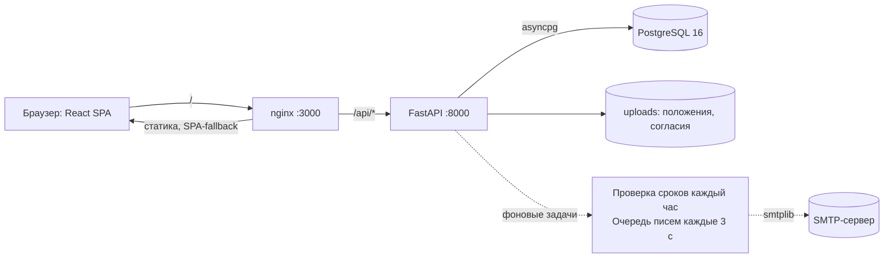
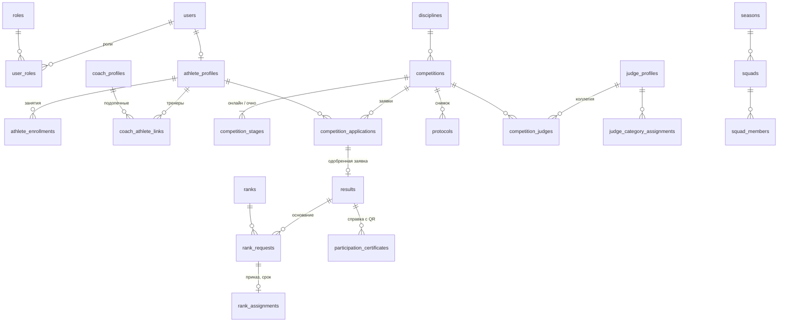

# Единая цифровая платформа ФСП Оренбургской области

Хакатон «ОренКод 2026». Платформа Федерации спортивного программирования Оренбургской области:
реестр спортсменов, тренеров, судей и организаций, календарь соревнований (ЕКП / региональный план),
заявки, автоматические протоколы, разряды и судейские категории с контролем сроков, рейтинг и сборная региона,
отчёты и документы (.xlsx, .docx), справки с QR-кодом. Все **6 дисциплин** вида спорта: алгоритмическое,
продуктовое, ИБ, ИИ, робототехника, БАС. Все персональные данные в демо — вымышленные.

---

## 1. Технологический стек

| Слой | Технологии |
|---|---|
| Backend | Python 3.12, **FastAPI**, SQLAlchemy 2.0 (async, `Mapped[]`), asyncpg, Alembic, Pydantic v2, PyJWT, bcrypt |
| База данных | **PostgreSQL 16** (нативные enum, частичные уникальные индексы, JSONB) |
| Frontend | **React 18**, Vite, TypeScript, Material UI v6, React Router 6, TanStack Query |
| Документы | openpyxl (.xlsx), python-docx (.docx), qrcode (QR-коды) |
| Уведомления | личный кабинет + почта (SMTP, очередь отправки в БД); восстановление пароля по ссылке на email |
| Тесты | pytest, pytest-asyncio, httpx (ASGI-клиент, отдельная тестовая БД) |
| Инфраструктура | **Docker Compose**: `db`, `api`, `frontend` (nginx + SPA-fallback + прокси `/api`) |

---

## 2. Запуск в одну команду

Требуется только Docker Desktop (или Docker Engine + Compose v2).

```bash
docker compose up -d --build
```

Файл `.env` **не нужен**: у всех переменных есть значения по умолчанию. Чтобы изменить настройки (SMTP почты, порты, ключ JWT),
скопируйте `.env.example` в `.env` и отредактируйте.

Что происходит при старте `api`: ожидание БД → `alembic upgrade head` (миграции 001–002) → заполнение
**пустой** БД справочниками и демо-данными 2023–2027 (`SEED_ON_START=true`) → запуск сервера.

| Адрес | Что там |
|---|---|
| http://localhost:3000 | Интерфейс (публичный навигатор, вход, кабинеты) |
| http://localhost:8000/api/v1/docs | Swagger UI: все 85 операций API |
| http://localhost:8000/api/v1/health | Проверка живости и подключения к PostgreSQL |

Контрольная проверка (на Windows с системным прокси добавьте `--noproxy '*'`):

```bash
curl -i http://localhost:3000/api/v1/health      # 200 {"status":"ok","database":"ok"}
```

Полезные команды:

```bash
docker compose exec api pytest                          # автотесты (30)
docker compose exec api python -m app.seed --reset      # вернуть чистые демо-данные
docker compose down -v                                  # остановить и удалить данные БД
```

Переменные окружения (необязательный `.env`, все описаны в `.env.example`):

| Переменная | Назначение |
|---|---|
| `POSTGRES_USER/PASSWORD/DB` | доступ к БД |
| `SECRET_KEY` | ключ подписи JWT (смените вне демо) |
| `SEED_ON_START` | `true` — наполнить пустую БД демо-данными при старте |
| `SMTP_HOST`, `SMTP_PORT`, `SMTP_USER`, `SMTP_PASSWORD`, `SMTP_USE_TLS`, `SMTP_FROM` | почтовый канал уведомлений и писем восстановления пароля (пусто — канал выключен, ссылка сброса пароля пишется в лог `api`) |
| `PUBLIC_BASE_URL` | адрес, на который ведёт QR-код справки (`/verify/<uuid>`) |
| `API_PORT`, `FRONTEND_PORT`, `DB_PORT` | порты на хосте |

---

## 3. Тестовые учётные записи

Пароль у **всех** — `Demo12345!`. Домен — `@fsp-demo.example.com`. На странице `/login` есть кнопки входа одним нажатием.
Даты в графе «что тестировать» указаны на момент генерации демо-данных (26.10.2026); актуальный список истекающих
сроков всегда виден в «Кабинет федерации → Контроль сроков».

| Логин | Роль | Что на ней тестировать |
|---|---|---|
| `admin@` | **Федерация + Судья** (мульти) | Всё управление: календарь, модерация, результаты, протоколы, приказы, рейтинг, сборная, отчёты; переключение роли на «Судья» (С1). Категория судьи у этого аккаунта истекла — система не даст назначить его в коллегию |
| `federation2@` | Федерация | То же без мульти-роли |
| `coach05@` | Тренер | Подопечные (у `athlete107` разряд и результаты), заявка за подопечного на соревнование и на разряд, справка по подопечному |
| `coach07@` | Тренер | Больше всего подопечных (20): таблицы, сроки разрядов |
| `coach13@` | Тренер | Отправил запросы на привязку (`athlete050`, `athlete068`), ждут подтверждения спортсменом (С4) |
| `coach01@` | **Тренер + Судья** (мульти) | Переключение ролей, 16 подопечных |
| `athlete.coach@` | **Спортсмен + Тренер** (мульти) | С1: вход спортсменом → переключатель → «Тренер» → 403 на чужих экранах |
| `athlete073@` | Спортсмен (14 лет) | Алгоритмическое — **без тренера**: сам подаёт заявки и заявку на разряд (С3, С7). Робототехника — тренер `coach14`: заявку подаёт тренер, спортсмену 403. История с победами, справка с QR (Д10) |
| `athlete001@` | Спортсмен (12 лет) | Только алгоритмическое, без тренера. Проверка возраста: на соревнования 14–17 заявку не подать |
| `athlete050@` | Спортсмен | Входящий запрос от `coach13` — подтвердить/отклонить (С4) |
| `athlete035@` | Спортсмен | Разряд «II юношеский» истекает 05.11.2026 — плашка-предупреждение в кабинете (С7) |
| `athlete051@` | Спортсмен | Действующая дисквалификация (до 14.11.2026): не попадает в рейтинг, заявку подать не может |
| `judge03@` | Судья | Категория 1-й до 15.11.2026 — предупреждение; заявка на подтверждение ждёт решения федерации (С6) |
| `judge01@` | Судья | Действующая категория до 2029; подаёт заявку на повышение; назначается в коллегии |
| `judge04@`, `judge05@` | Судья | Категория истекла — сервер откажет в назначении на соревнование |
| `athlete002@`…`athlete170@`, `coach01@`…`coach14@`, `judge01@`…`judge12@` | по логину | Остальные демо-пользователи |

---

## 4. Для жюри: критерий → сценарий → где и как проверить

Все ссылки — на локальный стенд. «UI» — шаги в интерфейсе, «API» — эндпоинты (префикс `/api/v1`, полная схема в Swagger).

### Работоспособность прототипа (С1–С7)

| № | Сценарий | Где и как проверить в UI | API |
|---|---|---|---|
| **С1** | Несколько ролей, переключение, права по активной роли | [/login](http://localhost:3000/login) → «Мульти-аккаунт» → в шапке селектор роли → «Тренер»; затем открыть в роли тренера `/federation` — предупреждение «доступно только для роли…» | `POST /auth/login`, `POST /auth/switch-role`, `GET /auth/me`, диагностика `GET /rbac/{federation,athlete,coach,judge}` (403 при чужой активной роли) |
| **С2** | Федерация создаёт и публикует соревнование: дисциплина, статус, тип, возрастные группы, календарный план, положение | Вход «Федерация» → [Календарь](http://localhost:3000/calendar) → «Создать соревнование» ([/competitions/new](http://localhost:3000/competitions/new)): ЕКП/региональный план с номером, этапы с форматом онлайн/очно, загрузка положения; на карточке — «Скачать положение». Типы соревнований федерация пополняет сама: Кабинет → «Справочники» | `POST /competitions`, `POST/PATCH /reference/competition-types`, `PATCH /competitions/{id}`, `POST/GET /competitions/{id}/regulation`, `GET /competitions?discipline=&status=&year=` |
| **С3** | Заявка спортсмена/тренера, проверка возраста и дисциплины, модерация | `athlete073` → Календарь (фильтр по возрастной группе, переключатель «Только подходящие мне», чип «Вам подходит») → соревнование → «Подать заявку» (в диалоге проверка возраста и дисциплины). Федерация → карточка соревнования → вкладка «Заявки» → «Одобрить / Отклонить». Тренер подаёт за подопечного там же | `POST /competitions/{id}/applications`, `PATCH …/applications/{app_id}`, `GET /federation/applications` |
| **С4** | Тренер привязывает спортсмена, спортсмен подтверждает | `coach13` → «Привязка и уведомления» → дисциплина + поиск спортсмена в реестре по фамилии. `athlete050` → «Профиль» → «Мои тренеры и запросы» → «Подтвердить». Тренер видит спортсмена на вкладке «Подопечные». Связь можно приостановить, возобновить и завершить (тренер — меню «⋯» в колонке «Связь», спортсмен — кнопки в профиле); «История» показывает все смены статуса с автором и комментарием | `POST /coach/athletes/link-request`, `GET/PATCH /athlete/coach-requests`, `GET /coach/athletes?with_suspended=true`, `PATCH /links/{id}`, `GET /links/{id}/history`, `GET /registry/athletes?q=` |
| **С5** | Результаты → автоматический протокол → история спортсмена | Федерация → соревнование → «Закрыть приём заявок» → вкладка «Результаты и протокол» → ввести баллы/задачи/время → «Опубликовать протокол» (места 1…N, ничьи, неявки). Результат сразу в «Кабинет спортсмена → История выступлений» | `POST …/results`, `POST …/publish-protocol`, `GET …/protocol`, `GET /athletes/{id}/history` |
| **С6** | Судейская коллегия, назначения, заявка на категорию | Федерация → соревнование → «Судейская коллегия» → «Назначить судью» (должность). `judge03` → «Кабинет судьи»: категория со сроком, назначения; «Заявка на категорию». Федерация → «Заявки судей» → «Рассмотреть» (приказ, срок 4 года) | `POST/GET/DELETE /competitions/{id}/judges`, `GET /judges/me/assignments`, `POST /judges/me/category-requests`, `PATCH /federation/judge-requests/{id}` |
| **С7** | Заявка на разряд (тренер **или** спортсмен без тренера), приказ, предупреждения о сроках | `athlete073` → «Разряды» → «Подать на разряд» (по алгоритмическому; по робототехнике — подсказка, что подаёт тренер). `coach05` → «Подопечные» → «Заявка на разряд». Федерация → «Заявки на разряды» → «Рассмотреть» (номер/дата приказа, срок по умолчанию 2 года). Предупреждения: плашка у `athlete035`, «Контроль сроков» 30/60 дней, колокольчик. Подсветка ЕВСК в протоколе: федерация → завершённое соревнование (например [№ 111](http://localhost:3000/competitions/111)) → «Результаты и протокол», колонка «ЕВСК» | `POST /ranks/requests`, `PATCH /federation/rank-requests/{id}`, `GET /ranks/expiring?days=30\|60`, `GET /athletes/me/ranks`, `POST /federation/expiry-check`, `GET /competitions/{id}/protocol` (поле `evsk`) |

### Соответствие функциональным требованиям (С8–С10, Д)

| № | Сценарий | Где и как проверить в UI | API |
|---|---|---|---|
| **С8** | Реестр занимающихся и динамика численности, выгрузка .xlsx | Федерация → [Реестр](http://localhost:3000/registry): вкладки «Спортсмены / Тренеры / Судьи / Организации», поиск по ФИО и фильтры по дисциплине, организации (в т. ч. «без организации»), разряду, возрастной группе, муниципалитету; «Выступления» — история спортсмена и справка .docx. [Отчёты](http://localhost:3000/reports) → «Выгрузить отчёт о численности (.xlsx)»: 6 листов (сводка с диаграммой, муниципалитеты, организации, дисциплины, возрастные группы, дисциплины × возраст), динамика 2024–2026 | `GET /registry/athletes\|coaches\|judges\|organizations`, `GET /analytics/headcount`, `GET /analytics/headcount/export?year_from=&year_to=` |
| **С9** | Рейтинг по дисциплинам, прозрачный расчёт, сборная и проект приказа | [Рейтинг](http://localhost:3000/rating): фильтры сезон/дисциплина/возраст/мин. разряд; стрелка у строки раскрывает расчёт («130 × 1,2 = 156»); дисквалифицированные исключены; федерация: «Выбрать топ-5» → «Сформировать сборную» → вкладка «Сборные команды» → «Утвердить приказом», «Проект приказа (.docx)» | `GET /rating`, `GET/PUT /rating/settings`, `POST /squads`, `POST /squads/{id}/approve`, `GET /squads/{id}/order-project` |
| **С10** | Документы по формам: протокол, отчёт по спортсмену | Карточка завершённого соревнования → «Протокол (.docx)» (титульный лист, все участники, коллегия, подписи). «Кабинет спортсмена → История» → «Справка (.docx)»; у тренера — «Справка» по подопечному | `GET /competitions/{id}/protocol/export`, `GET /athletes/me/report/export`, `GET /athletes/{id}/report/export` |
| **П.8** | Уведомления в кабинет и во внешний канал: **почта** | Любой кабинет → «Уведомления на почту» → тумблер включения (почта уже известна из регистрации, привязка не нужна). Затем любое событие (модерация заявки, протокол, решение по разряду) приходит в кабинет (колокольчик) и письмом на email. Без `SMTP_HOST` письма не уходят, но запись в кабинет остаётся | `PUT /me/notification-settings`, `GET /me/notification-settings`, `POST /federation/expiry-check` |
| **Д10** | Справка об участии с QR-кодом и публичной проверкой | `athlete073` → История → кнопка «Справка» в строке турнира: документ с номером и QR (.docx), в «Мои справки» — QR и ссылка. Без входа открыть ссылку QR: `/verify/<uuid>` — «Справка подлинная»: ФИО, турнир, дисциплина, место (дата рождения не раскрывается) | `POST /athletes/me/certificates`, `GET …/{id}/export`, публичные `GET /public/certificates/{uuid}`, `GET /public/certificates/{uuid}/qr.png` |
| **Д11** | Навигатор для новичка (без авторизации) | [Главная /](http://localhost:3000/): вид спорта, 6 дисциплин, как начать, организации по муниципалитетам, ближайшие соревнования, быстрая регистрация с согласием на ПДн ([/register](http://localhost:3000/register)) | `GET /public/navigator`, `GET /public/options`, `POST /auth/register` |

Не реализованы (осознанно, за 48 часов): Д1 (ФСП ID / OIDC), Д2 (интеграции), Д3 (группы и журнал занятий; этап подготовки хранится в карточке занятий), Д4 (нормативы ФССП), Д5 (апелляции), Д6 (показатели развития; частично — динамика численности), Д7 (личный путь), Д8 (премии Губернатора), Д9 (кабинет министерства; роль `ministry` зарезервирована), Д12 (отдельные документы о судействе; состав коллегии выводится в протоколе).

### Технологичность, презентация, потенциал

| Критерий | Где смотреть |
|---|---|
| **Т1.** Архитектура, API, права на сервере, тесты, README, развёртывание | Раздел 6–7 этого файла; Swagger `/api/v1/docs`; `docker compose exec api pytest` (30 тестов); `docker compose up -d --build` |
| **Т2.** Структура данных, валидация, демо-данные по 6 дисциплинам за 2+ года | Раздел 8; проверочный запрос ниже |
| **П3.** UX/UI: стиль ФСП, адаптивность, пустые состояния, подсказки | Любой экран на ПК и смартфоне (проверено на 390 px — без горизонтальной прокрутки), пустые состояния («Очередь пуста», «Справок пока нет»), чипы «Вам подходит», подсказка ЕВСК в заявке на разряд |
| **Р1.** Правила вида спорта и процессы федерации | Возрастные группы, статусы и типы (справочник) соревнований, ЕКП/региональный план с номером, формат этапа онлайн/очно, сроки разрядов (2 года) и категорий (4 года), подсказка соответствия ЕВСК |
| **Р2.** Собственные сценарии | Регистрация с согласием на ПДн и загрузкой скана, проверка сложности пароля и формата email; восстановление пароля по ссылке на почту ([/forgot-password](http://localhost:3000/forgot-password)); антидопинг (РУСАДА); фоновые напоминания о сроках за 60/30/7 дней; уведомления в кабинете и на почту (тумблер в кабинете); рассылка об открытии регистрации подходящим по возрасту и дисциплине; напоминания о закрытии приёма заявок и о сроке ходатайств на премии Губернатора; журнал действий с фильтрами (Кабинет → «Журнал действий»); дисквалификации и отстранения с исключением из рейтинга и заявок (Кабинет → «Дисквалификации»); дашборд федерации с очередью действий; справка с QR; настройка таблицы баллов рейтинга |

Проверка демо-данных (Т2): результаты по дисциплинам и годам из опубликованных протоколов:

```bash
docker compose exec db psql -U fsp -d fsp -c "
select d.code, extract(year from c.start_date)::int as year, count(r.id) as results
from results r join competitions c on c.id=r.competition_id join disciplines d on d.id=c.discipline_id
group by 1,2 order by 1,2"
```

Сквозной сценарий за 3 минуты: `admin@` создаёт соревнование (приём заявок открыт) → `athlete073@` подаёт заявку →
`admin@` одобряет → «Закрыть приём» → вводит результаты → «Опубликовать протокол» → у `athlete073@` результат в истории,
уведомление в колокольчике; «Протокол (.docx)» и «Справка» с QR доступны для скачивания.

---

## 5. Архитектура



Структура репозитория:

```
├── docker-compose.yml      db + api + frontend
├── .env.example
├── backend/
│   ├── alembic/versions/   001_initial (43 таблицы) … 005_email_channel_password_reset
│   ├── app/
│   │   ├── core/           config, database, security (JWT, bcrypt), deps (require_role), audit
│   │   ├── models/         SQLAlchemy 2.0: справочники, люди, соревнования, результаты, разряды, сборная, система
│   │   ├── schemas/        Pydantic v2: валидация входа и форма ответов
│   │   ├── routers/        19 модулей: auth, competitions, applications, results, ranks, judges, rating, documents…
│   │   ├── services/       бизнес-правила: допуск к заявке, ранжирование, рейтинг, сроки, уведомления, почта, восстановление пароля
│   │   ├── reports/        генераторы .xlsx / .docx / QR
│   │   └── seed/           справочники и вымышленная история 2023–2027
│   └── tests/              pytest на отдельной БД
└── frontend/
    └── src/                api (клиент, типы), auth, components, pages, theme
```

Принципы:

- **Слои.** Роутер принимает и проверяет доступ → сервис применяет правила → модели/БД. Правила (возраст, «тренер или спортсмен», ранжирование, рейтинг) живут в `services/` и не дублируются в интерфейсе: UI даёт подсказки, решение всегда за сервером.
- **Данные согласованы на уровне БД:** внешние ключи `ON DELETE RESTRICT`, CHECK по датам и местам, частичные уникальные индексы (одна живая заявка на соревнование; одна живая связка «тренер—спортсмен—дисциплина»), нативные enum.
- **Протокол неизменяем:** публикуется как JSONB-снимок со всеми участниками; после публикации результаты заморожены.
- **История выступлений** — запрос по результатам опубликованных протоколов, отдельной таблицы нет, рассинхрон невозможен.
- **Журнал действий** (`audit_log`): вход, смена роли, создание и изменение сущностей, решения федерации, санкции, изменения справочников, антидопинг и скан согласия, выгрузки. Федерация смотрит его в кабинете с фильтрами по действию, автору и датам (`GET /federation/audit-log`).
- **Уведомления (п. 8 кейса):** запись в кабинет всегда; на почту — через очередь доставок в БД (`notification_deliveries`: pending → sent / failed с текстом ошибки) и фоновую отправку, запрос пользователя не ждёт SMTP. События: открытие регистрации (спортсменам, проходящим по дисциплине и возрасту, и их тренерам), смена статуса заявки, публикация протокола, заявки и решения по разрядам и судейским категориям, запрос на привязку тренера, закрытие приёма заявок через ≤ 3 дня (кто ещё не подал + федерация), истечение разрядов и категорий (60/30/7 дней; на почту — за 7), ходатайства на премии Губернатора до 1 февраля (за 30 и 7 дней). Повторы исключает `dedup_key`. Санкция федерации уведомляет спортсмена и его тренеров.
- **Почта:** внешний канал — email, указанный при регистрации (привязка не нужна, в кабинете только тумблер вкл/выкл). Отправка — `smtplib` поверх `asyncio.to_thread`, без `SMTP_HOST` канал выключен, но запись в кабинет и очередь продолжают работать.
- **Восстановление пароля:** `POST /auth/forgot-password` по email выпускает одноразовый токен (`secrets.token_urlsafe`, в БД хранится только его SHA-256-хэш, срок — `PASSWORD_RESET_TTL_MINUTES`, по умолчанию 60 минут) и письмом присылает ссылку `/reset-password?token=...`; ответ одинаков независимо от того, существует ли такой email (защита от перебора). `POST /auth/reset-password` проверяет токен, меняет пароль и помечает токен использованным. Без настроенного SMTP ссылка пишется в лог `api` (`docker compose logs api`) — так жюри может проверить сценарий без реальной почты.
- **Конфиденциальность:** пароли — bcrypt, при регистрации и сбросе пароля проверяется сложность (≥ 8 символов, строчная и заглавная буква, цифра, спецсимвол); публичная проверка справки не раскрывает дату рождения и контакты; согласие на ПДн принимается при регистрации, для несовершеннолетних — данные законного представителя, скан подписанного документа загружается в кабинете.

---

## 6. Ролевая модель

Один аккаунт может иметь несколько ролей: `federation`, `athlete`, `coach`, `judge` (`ministry` зарезервирована).
**Активная роль** хранится в JWT (`sub`, `roles`, `active_role`, срок 8 часов). Переключение — `POST /auth/switch-role`
(возвращает новый токен, повторный вход не нужен).

Проверка только на сервере, через зависимость FastAPI:

```python
@router.post("/competitions")
async def create(data: CompetitionCreate, current: Annotated[CurrentUser, Depends(require_role(RoleCode.FEDERATION))]): ...
```

- `get_current_user` на **каждом** запросе сверяет роли токена с БД: токен с подделанной `active_role` отклоняется (401), отозванная роль перестаёт работать сразу.
- `require_role(*roles)` пропускает, только если **активная** роль входит в список. Наличие роли у аккаунта недостаточно: пользователь «спортсмен + тренер», работающий как спортсмен, получает 403 на тренерских эндпоинтах.
- Пересечения ролей дополнительно ограничены данными: спортсмен видит свою историю, тренер — только активных подопечных, судья — свои назначения.

| Роль | Основные возможности |
|---|---|
| Федерация | Реестр, справочники (типы соревнований), календарь и планы, модерация заявок, судейские коллегии, результаты и протоколы, приказы о разрядах и категориях, рейтинг и сборная, дисквалификации, журнал действий, отчёты, контроль сроков |
| Спортсмен | Профиль, антидопинг, согласие, заявки на соревнования (если нет тренера по дисциплине), подтверждение тренера, история, заявка на разряд (если нет тренера), справки с QR |
| Тренер | Привязка спортсменов, заявки на соревнования и разряды подопечных, сроки их разрядов |
| Судья | Категория и срок, назначения, заявка на присвоение/подтверждение категории |

Взаимоисключение «тренер или спортсмен»: если у спортсмена есть **активная** связка с тренером по дисциплине, заявки на
соревнование и на разряд по ней подаёт только тренер (спортсмену — 403); без тренера — подаёт сам.

---

## 7. Модель данных

44 таблицы (43 предметные + `alembic_version`). Группы:

| Группа | Таблицы |
|---|---|
| Справочники | `disciplines` (6), `age_groups`, `competition_types`, `ranks`, `judge_categories`, `judge_positions`, `rank_requirements` (подсказки ЕВСК), `municipalities`, `organizations`, `seasons`, `rating_rules`, `rating_settings` |
| Люди и роли | `users`, `roles`, `user_roles`, `athlete_profiles`, `coach_profiles`, `judge_profiles`, `athlete_enrollments` (занятия: дисциплина, организация, этап подготовки, период — основа реестра и отчёта о численности), `consents`, `stored_files` |
| Тренер—спортсмен | `coach_athlete_links` (статус, дисциплина), `coach_link_history` |
| Соревнования | `competitions` (уровень, `rating_tier`, календарный план + номер), `competition_stages` (формат онлайн/очно на этапе), `competition_age_groups`, `teams`, `competition_applications`, `competition_judges` |
| Результаты | `results`, `protocols` (JSONB-снимок), `sanctions` |
| Разряды и категории | `rank_requests`, `rank_assignments`, `judge_category_requests`, `judge_category_assignments` |
| Сборная | `squads`, `squad_members` |
| Система | `notifications`, `notification_deliveries` (канал, статус), `audit_log`, `participation_certificates` (QR-токен), `content_pages` |



---

## 8. API

85 операций, группы (полные описания и схемы — Swagger `/api/v1/docs`):

| Группа | Эндпоинты |
|---|---|
| Авторизация | `/auth/login`, `/auth/register`, `/auth/me`, `/auth/switch-role`, `/auth/forgot-password`, `/auth/reset-password` |
| Публичные | `/public/navigator`, `/public/options`, `/public/certificates/{uuid}[/qr.png]` |
| Соревнования | `/competitions` (+ фильтры), `/competitions/{id}`, `…/regulation`, `…/applications`, `…/judges`, `…/results`, `…/publish-protocol`, `…/protocol` |
| Тренер—спортсмен | `/coach/athletes`, `/coach/athletes/link-request`, `/athlete/coach-requests` |
| Разряды и категории | `/ranks/requests`, `/ranks/expiring`, `/athletes/me/ranks`, `/federation/rank-requests`, `/judges/me/*`, `/federation/judge-requests` |
| Рейтинг и сборная | `/rating`, `/rating/settings`, `/rating/seasons`, `/squads` |
| Документы | `…/protocol/export`, `/athletes/{id}/report/export`, `/squads/{id}/order-project`, `/analytics/headcount/export` |
| Справки | `/athletes/me/certificates`, `…/{id}/export` |
| Кабинеты | `/athletes/me/profile`, `/athletes/me/history`, `/federation/dashboard`, `/federation/applications`, `/federation/audit-log`, `/federation/sanctions` |
| Реестр | `/registry/athletes` (федерация и тренер; тренеру без контактов), `/registry/coaches`, `/registry/judges`, `/registry/organizations` |
| Связь тренер–спортсмен | `/coach/athletes/link-request`, `/athlete/coach-requests`, `PATCH /links/{id}`, `GET /links/{id}/history` |
| Уведомления и профиль | `/notifications`, `PUT /me/notification-settings`, `/me/consent`, `POST /federation/expiry-check` |
| Справочники | `/reference/*`; федерация пополняет типы соревнований: `POST/PATCH /reference/competition-types` |
| Диагностика | `/health`, `/rbac/*` |

---

## 9. Тесты

```bash
docker compose exec api pytest
```

Набор из 30 асинхронных тестов работает на **отдельной БД `fsp_test`**: она создаётся заново на каждый запуск настоящими
миграциями Alembic (заодно проверяется их применимость с нуля), каждый тест идёт в откатываемой транзакции, демо-данные не
затрагиваются. Покрыто:

- **Права (С1):** своя роль → 200, чужая → 403, переключение роли меняет права, подделанная `active_role` и подмена подписи → 401, нельзя переключиться на неназначенную роль.
- **Валидация заявки (С3):** возраст вне группы (слишком молод и слишком стар), несовпадение дисциплины, дубль → 409, спортсмену с тренером → 403, заявка тренера проходит.
- **Рейтинг (С9):** коэффициент ×1,2 при двух призовых местах (70 × 1,2 = 84), без коэффициента при одном, исключение дисквалифицированного, прозрачная разбивка, изменение коэффициента в настройках.
- **Уведомления и почта:** постановка в очередь и отправка (`sent`), без `SMTP_HOST` канал не ставится в очередь, выключенный тумблер `email_notifications_enabled` — тоже; открытие регистрации уведомляет только подходящих по возрасту и дисциплине; напоминания о закрытии приёма заявок и о премиях Губернатора без дублей.
- **Восстановление пароля:** запрос токена не раскрывает, существует ли email; токен одноразовый и ограничен по сроку, слабый пароль при сбросе → 422, после смены пароля вход старым паролем не проходит, новым — проходит.
- **Реестр, связи, санкции, справочник, ЕВСК, календарь:** фильтр реестра по дисциплине, поиск тренером без email, 403 спортсмену и тренеру на чужие разделы; приостановка → возобновление → завершение связи с историей и уведомлениями, 409 на недопустимый переход, 404 чужому тренеру; санкция блокирует заявку и попадает в журнал, срок только сокращается; дубль типа соревнования → 409, отключённый тип скрыт из формы; ЕВСК в протоколе видна только федерации; «подходят мне» и фильтр по возрастной группе.
- **Справка с QR (Д10):** выпуск, идемпотентность, публичная проверка без авторизации (без даты рождения), PNG-QR, .docx с вложенной картинкой, чужой результат → 404.

Чувствительность тестов проверена мутациями (намеренно ломались коэффициент, проверка возраста и `require_role` — каждая поломка роняла соответствующие тесты).

---

## 10. Допущения и ограничения

- Возрастные группы и пороги ЕВСК в демо — условные значения, федерация может менять справочники; реальных таблиц правил в материалах кейса нет. Возраст считается на дату старта соревнования.
- Правило ранжирования общее для всех дисциплин: больше баллов → больше решённых задач → меньше времени; равные результаты делят место.
- Почта: без реального SMTP-провайдера у команды (`SMTP_HOST` не задан) письма не уходят — ссылка восстановления пароля и текст уведомлений пишутся в лог `api`, этим жюри может проверить сценарий целиком. Неудачные отправки не повторяются автоматически.
- Токены без состояния: после смены роли прежний токен действует до истечения (с прежней ролью).
- Демо-данные генерируются относительно текущей даты: «скоро истекает» и «приём заявок открыт» всегда актуальны.

Дизайн-система (палитра, типографика, паттерны, плейсхолдеры под логотипы и карту): [docs/design-system.md](docs/design-system.md).

Нормативная основа кейса: 329-ФЗ «О физической культуре и спорте», 152-ФЗ «О персональных данных», правила вида спорта
(приказ Минспорта № 584), ФССП (приказ № 445), ЕВСК.
